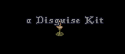

# Disguise Kit

<figure><figcaption></figcaption></figure>

Disguise Kit, kimliğinizi bir süreliğine tamamen gizlemenizi sağlayan tek kullanımlık bir kılık değiştirme setidir. \
Kiti kullandığınızda yeni bir isimle ve baştan seçtiğiniz bir görünüşle dolaşırsınız; çevrenizdeki oyuncular karşılarında kimin durduğunu anlayamaz.

İster bir hırsızlık planı için ister sadece rol yapmak için olsun, birkaç saatliğine başka biri olmak hiç bu kadar kolay olmamıştı.

<mark style="color:red;">**Kılık 2 saat sürer ve süre dolduğunda otomatik olarak eski isminize ve görünüşünüze dönersiniz.**</mark>

### Nasıl Elde Edilir? 

Disguise Kit, şehirlerdeki <mark style="color:red;">**Provisioner**</mark> NPC'lerinden satın alınabilir. Kit tek kullanımlıktır; kılığı onayladığınız anda kit çantanızdan silinir.

### Kullanım 

Kiti kullanmak için çantanızın <mark style="color:red;">**üst kısmında**</mark> olması gerekir (çanta içindeki başka bir çantada ya da bankada kullanılamaz). \
Kite çift tıkladığınızda kılık ekranı açılır. Ekran, şu anki görünüşünüzle başlar ve yaptığınız her seçim soldaki önizlemede anında görünür.

### Disguise Kit ekranı

Ekranın solunda üç sekme bulunur:

• <mark style="color:red;">**Saç**</mark> – 9 farklı saç stilinden birini seçebilir ya da boş kartı işaretleyerek saçsız dolaşabilirsiniz.\
• <mark style="color:red;">**Sakal**</mark> – 7 farklı sakal / bıyık stilinden birini seçebilir ya da sakalsız bir görünümü tercih edebilirsiniz. Bu sekme yalnızca erkek karakterlerde görünür.\
• <mark style="color:red;">**Renk**</mark> – 57 ten rengi ile 32 saç ve sakal rengi arasından seçim yapabilirsiniz.

Karar veremiyorsanız <mark style="color:red;">**Rastgele**</mark> butonu saç, sakal, ten, saç rengi ve sakal rengini sizin için rastgele belirler. Beğenmezseniz tekrar basabilir ya da istediğiniz kısmı elle değiştirebilirsiniz.

Seçiminizden memnun olduğunuzda <mark style="color:red;">**Onayla**</mark> butonuna basın. Karakterinize rastgele yeni bir isim verilir ve kılığınız hemen uygulanır.

{% embed url="https://files.gitbook.com/v0/b/gitbook-x-prod.appspot.com/o/spaces%2FsfsUbVM9k2zNqazagdML%2Fuploads%2Fus3De5IwqSn0RDZIPPo7%2Fdisguise%20kit.mp4?alt=media&token=59dcbf96-1612-4c5d-9c92-0b883c3dc40b" %}

### Kılık Süresince 

• Yeni isminizle görünürsünüz; <mark style="color:red;">**guild etiketiniz ve unvanlarınız gösterilmez**</mark>**.**\
• Kılığın kalan süresi buff ikonunda görünür ve oyundan çıkıp girseniz de devam eder.\
• <mark style="color:red;">**Ölmek kılığı bozmaz**</mark>; dirildiğinizde aynı ten rengi ve görünüşle devam edersiniz.\
• Kılıktayken <mark style="color:red;">**Incognito**</mark> ve <mark style="color:red;">**Polymorph**</mark> büyülerini kullanamazsınız.

Süre dolduğunda eski isminiz, saçınız, sakalınız ve ten renginiz kendiliğinden geri gelir.

### Kimliğiniz İfşa Olursa 

Kılıktayken tanındıysanız yeni bir Disguise Kit ile **t**<mark style="color:red;">**ekrar kılık değiştirebilirsiniz**</mark>. Yeni kılıkta rastgele yeni bir isim alırsınız, görünüşünüzü baştan seçersiniz ve <mark style="color:red;">**2 saatlik süre yeniden başlar**</mark>.

Gerçek kimliğiniz kaybolmaz: kaç kez kılık değiştirirseniz değiştirin, süre dolduğunda ilk kılığınıza değil, <mark style="color:red;">**kendi isminize ve görünüşünüze**</mark> dönersiniz.

• Ölüyseniz\
• Polymorph gibi bir büyüyle farklı bir görünüşteyseniz\
• Incognito etkisi altındaysanız\
• Bir etkinlik, War Zone ya da PvP içindeyseniz kılık değiştiremezsiniz
