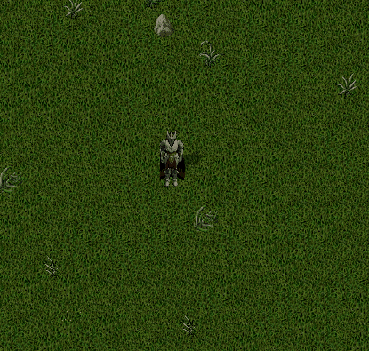

# 13.10.2026 Güncellemeleri

* Craft menülere Tooltip eklendi. Artık üretmek istediğiniz eşyanın üzerine geldiğinizde üretimi için gereken malzemeleri görüntüleyebileceksiniz
* MF silahların Pure Mage karakterlere karşı stam düşürme oranları güncellendi

Normal şartlarda tek el silahlar karakterin %10-14, çift el silahlar ise %13-17 stamını düşürmekte, Stam Shot ile bu oran 2 katına çıkmakta Güncelleme sonrası Pure mage karakterlerin stam miktarı tek el silahlar ile %15-20, çift el silahlar ile %20-25 oranında azalacak. Stam Shot bonusu yine aynı şekilde 2 kat stam azaltacak

* Spirit Speak yeteneğinin Freeze süresi <mark style="color:red;">**1 saniyeden 1.3 saniyeye**</mark> yükseltildi
* Stealing yeteneğinin düşük yetenek seviyesinde crim olma ihtimalleri arttırıldı

Eski ve yeni criminal olma şansları Resim1 de yer almaktadır

<figure><figcaption></figcaption></figure>

* Vendor arama ekranında artık Container tipi eşyaların içeriklerini görüntüleyebileceksiniz
* .wiki komutu yeni wiki sayfasına yönlendirilecek şekilde güncellendi
* Guild dialogunda çeşitli iyileştirmeler yapıldı ve Tooltipler eklendi
* Guild sisteminde Master menüsüne Yardımcılar sekmesi eklendi. Guild Master en fazla 3 adet yardımcı seçebilecek

Yardımcılar guilde tam üye alabilecek, adayları onaylayabilecek veya adayları reddedebilecekler

<figure><figcaption></figcaption></figure>

* Guild adaylarının guild menüsünün bir kısmını görmesi sağlandı

Genel sekmesinden guildin genel durumunu görüntüleyebilir, Ayarlar sekmesinden guildden ayrılabilir ve Warzone sekmesinden Geçmiş Karşılaşmaları görüntüleyebilirsiniz

* Craft, Tamer, Hunter ve Gatherer görevlerini teslim ettiğinizde görevin tamamlandığına dair görsel bir bildirim alacaksınız
* Craft, Tamer, Hunter ve Gatherer Mastery seviyeniz arttığında seviye artışına dair görsel bir bildirim alacaksınız
* Craft Mastery sayesinde çift üretim yaptığınızda görsel bir bildirim alacaksınız

<figure><figcaption></figcaption></figure>

* Warzone sisteminde puanlama mantığı güncellendi

Kill artık 100 yerine 75 puan vermekte Heal Miktarı satırı artık oyuncunun kendine uyguladığı değil takım arkadaşlarına uyguladığı heal miktarını yansıtmakta

* Warzone sisteminde karşı guilddeki oyunculara bandaj kullanımı ve iyileştirici büyü kullanımı engellendi
* Warzone sisteminde yere atılan eşyaların silinme süresi 1 dakika olarak güncellendi. Normal şartlarda eşyaların silinme süresi 10 dakikadır
* Warzone sistemine girişte kutu, saman vs gibi geçişi engelleyen eşyalar artık silinmekte
* Warzone sisteminde region ayarlamaları yapıldı
* Warzone sistemine Delucia şehri aktif edildi. Hem Last Stand hem de Team Deathmatch modları artık bu haritada da oynanabilir
