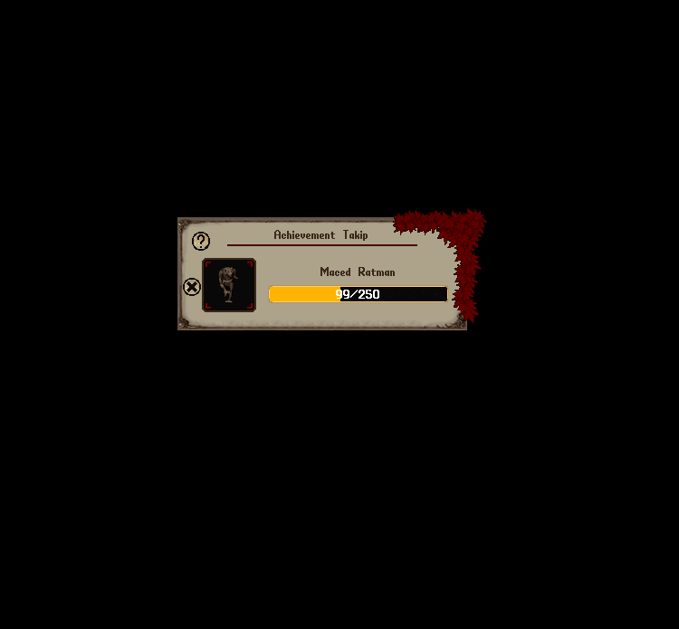

# Achievement Sistemi

Nimloth dünyasında ilerleyişinizi adım adım takip edebileceğiniz, başarılarınızı kayıt altına alabileceğiniz ve çeşitli ödüller kazanabileceğiniz kapsamlı bir başarı sistemi sizleri beklemekte.

Achievement sistemi bir görev sistemi değildir; tamamen gelişiminizi görmek, hedefler belirlemek ve bu hedeflere ulaştığınızda ödüller kazanmak üzerine kuruludur.

## Achievement Menüsüne Nasıl Ulaşılır?

Achievement sistemine erişmek için:

Help menüsüne tıklayın ve <mark style="color:red;">**Başarımlar**</mark> sekmesini seçin.

Bu ekranda farklı alanlardaki ilerlemenizi gösteren toplam 7 kategori bulunmaktadır:

• Craft

• PvM

• Tame

• PvP

• Etkinlik

• Dungeon

• Gatherer

Bu kategoriler oyun içerisindeki her hareketinizi kayıt altına alarak gelişiminizi görmenize yardımcı olur.

## Craft Achievementları

Craft Achievement’ları, sistemde tanımlı eşyaları ürettikçe ilerleyen başarımlardır. Üretimleriniz ilgili yetenek veya üretim kategorisi altında takip edilir:

* <mark style="color:red;">**Alchemy**</mark>**:** İksir üretimine ait başarımlar.
* <mark style="color:red;">**Blacksmith**</mark>**:** Metal silah, zırh ve diğer demircilik ürünlerine ait başarımlar.
* <mark style="color:red;">**Bowcraft**</mark>**:** Yay, arbalet ve mühimmat üretimine ait başarımlar.
* <mark style="color:red;">**Carpenter**</mark>**:** Mobilya ve diğer ahşap eşya üretimlerine ait başarımlar.
* <mark style="color:red;">**Cooking**</mark>**:** Yiyecek ve yemek hazırlamaya ait başarımlar.
* <mark style="color:red;">**Inscription**</mark>**:** Büyü parşömeni ve diğer yazıcılık ürünlerine ait başarımlar.
* <mark style="color:red;">**Tailor**</mark>**:** Giysi ve deri ekipman üretimine ait başarımlar.
* <mark style="color:red;">**Tinker**</mark>**:** Alet, takı ve diğer tinkering ürünlerine ait başarımlar.
* <mark style="color:red;">**Masonry**</mark>**:** Taş işçiliğiyle üretilen eşyalara ait başarımlar.
* <mark style="color:red;">**HouseCraft**</mark>**:** Ev üretimine ait başarımlar.
* <mark style="color:red;">**ShipCraft**</mark>**:** Gemi üretimine ait başarımlar.
* <mark style="color:red;">**Carving**</mark>**:** Balkabağı oyma çalışmalarına ait başarımlar.

Her eşyanın üretim sayısı ayrı tutulur. Listedeki eşyaya tıklayarak mevcut üretim sayınızı, üç seviyenin hedeflerini ve kazanabileceğiniz ödülleri görüntüleyebilirsiniz.

Her başarım <mark style="color:red;">**üç seviyeden**</mark> oluşur.&#x20;

Detay ekranında:

* Achievement’ın adı, kategorisi veya alt kategorisi, toplam ilerleme sayınız ve tamamladığınız seviye gösterilir.
* Üç seviyenin her biri ayrı bir bölümde yer alır. Her bölümde hedef miktarı, mevcut ilerlemeniz, tamamlanma yüzdesi ve kazanacağınız ödüller görüntülenir.
* Henüz tamamlanmayan seviyelerde hedefe ulaşmak için gereken kalan miktar belirtilir.
* Tamamladığınız seviyenin ödülünü <mark style="color:red;">**“Ödülü Al”**</mark> butonuyla alabilirsiniz. Ödüller sırayla alınır; ikinci seviyenin ödülünü almadan önce birinci seviyenin ödülünü almanız gerekir.
* Aldığınız ödüller <mark style="color:red;">**“Ödül alındı”**</mark> olarak işaretlenir. İşaretin üzerine geldiğinizde ödülü aldığınız tarihi görebilirsiniz.
* Ünvan ödülü bulunan Achievement’larda kazanılacak ünvan da gösterilir. Ünvan, üçüncü seviyenin ödülü alındığında kazanılır.

<figure><figcaption></figcaption></figure>

## PvM Achievementları

Nimloth dünyasında yalnızca üretim değil, savaş sanatları da birer başarı öyküsüdür.

PvM Achievement’ları, sistemde tanımlı yaratıkları öldürdükçe ilerleyen başarımlardır. Her yaratık için ilerlemeniz ayrı tutulur. Listedeki yaratığa tıklayarak toplam öldürme sayınızı, üç seviyenin hedeflerini ve ödüllerini görebilirsiniz.

Her seviyenin hedefini tamamladığınızda ilgili ödülü detay ekranından alabilirsiniz. PvM Achievement’ları ayrıca özel ünvan kazandırır. Bu ünvanlar, üçüncü seviyenin ödülü alındığında açılır ve profilinizden seçilebilir.

<figure><figcaption></figcaption></figure>

<figure><figcaption></figcaption></figure>

## Tame Achievementları

Nimloth’ta ehlileştirme sanatı yalnızca bir yetenek değil, aynı zamanda sabır ve ustalık isteyen bir yolculuktur.

Tame Achievement’ları, başarım sistemine dahil edilen yaratıkları ehlileştirdikçe ilerler. Her yaratığa ait ehlileştirme sayısı ayrı takip edilir. Başarımın detay ekranından mevcut ilerlemenizi ve üç seviyenin tamamlanması için gereken miktarları görüntüleyebilirsiniz.

<figure><figcaption></figcaption></figure>

<figure><figcaption></figcaption></figure>

## PvP Achievementları

PvP Achievement’ları, oyunculara karşı elde ettiğiniz öldürmeler üzerinden ilerleyen başarımlardır. Genel oyuncu öldürme başarımlarının yanında, zindan, Esyria ve War Zone gibi farklı bölgelerde veya belirli özelliklere sahip oyunculara karşı elde edilen öldürmeler de ayrı başarımlarda takip edilebilir.

Her başarımın hedeflerini, mevcut ilerlemenizi ve kazanabileceğiniz ödülleri detay ekranından görüntüleyebilirsiniz.

<figure><figcaption></figcaption></figure>

<figure><figcaption></figcaption></figure>

## Etkinlik Achievementları

Etkinlik Achievement'ları, sunucuda düzenlenen etkinliklere katıldıkça ve kazandıkça ilerleyen bir başarı sistemidir.

Etkinlik Achievement’ları, desteklenen etkinliklere katıldıkça veya bu etkinlikleri kazandıkça ilerler. Katılım ve zafer başarımları ayrı takip edilir; tamamlanması gereken hedefler etkinliğe ve başarım türüne göre değişir.

İlgili başarımın detay ekranından mevcut sayınızı, seviye hedeflerini ve ödüllerini görüntüleyebilirsiniz.

<figure><figcaption></figcaption></figure>

<figure><figcaption></figcaption></figure>

## Dungeon Achievementları

Dungeon Achievement’ları, 10 farklı zindanda elde ettiğiniz yaratık öldürmelerini ayrı ayrı takip eder:

Wrong, Shame, Hythloth, Destard, Despise, Covetous, Deceit, Fire Dungeon, Ice Dungeon ve Terathan Keep.

Her zindanın başarımı üç seviyeden oluşur. İlgili zindandaki öldürmelerinizle ilerleyebilir, seviye hedeflerini tamamladığınızda ödüllerinizi alabilirsiniz. Üçüncü seviye ödülünü aldığınızda o zindana ait özel bir ünvan da kazanırsınız.

<figure><figcaption></figcaption></figure>

<figure><figcaption></figcaption></figure>

## Gatherer Achievementları

Gatherer Achievement’ları; toplama ve kaynak elde etme faaliyetlerini takip eder.

* <mark style="color:red;">**Mining**</mark>**:** Maden çıkarma ve madencilik sırasında elde edilen kaynaklara ait başarımlar.
* <mark style="color:red;">**Fishing**</mark>**:** Balık tutma ve balıkçılıkla elde edilen eşyalara ait başarımlar.
* <mark style="color:red;">**Lumberjacking**</mark>**:** Odun toplama ve Tree Grove faaliyetlerine ait başarımlar.
* <mark style="color:red;">**Farming**</mark>**:** Yetiştirdiğiniz ürünleri hasat etme ve çiftçilikten elde edilen ürünlere ait başarımlar.
* <mark style="color:red;">**Lockpicking**</mark>**:** Kilitli hazine ve zindan sandıklarını açmaya ait başarımlar.

Her yeteneğin altında, sistemde tanımlı kaynak veya faaliyetler için ayrı başarımlar bulunur. Örneğin farklı maden ve balık türlerinin ilerlemesi ayrı tutulur. İlgili başarıma tıklayarak mevcut sayınızı, üç seviyenin hedeflerini ve kazanabileceğiniz ödülleri görüntüleyebilirsiniz.

<figure><figcaption></figcaption></figure>

<figure><figcaption></figcaption></figure>

## Ödüller ve Ödül Alma Sistemi

Achievement sisteminde ilerledikçe, ana ekranda her bir Achievement için o seviyedeki ilerlemenizi gösteren bir ilerleme barı göreceksiniz.

Her başarı türünün içerisinde, detay ekranına girdiğinizde ise 1. 2. ve 3. seviyeler için ayrı ilerleme durumunuzu takip edebilirsiniz.

Bir seviyeyi tamamladığınızda, seviyenin tamamlandığına dair bir mesaj ve bilgilendirme alırsınız.

Ayrıca Achievement menüsünü açtığınızda o Achievement'ın rengi sarıdan yeşile dönecektir.

Detay sayfasına girdiğinizde ise o seviyeye ait **“Ödül Al”** butonu aktif hale gelir.

Butona tıklayarak ödülünüzü anında hesabınıza tanımlayabilirsiniz.

Tamamladığınız seviyeye göre Nimloth Puanı ve Achievement Puanı kazanırsınız.

Ödülü aldığınızda kazandığınız Achievement ve Nimloth puanı bilgisi mesaj olarak gösterilir.

Her seviyenin verdiği Nimloth ve Achievement puanları farklıdır.

• 1. Seviye Tamamlandığında **10 Nimloth Puanı + 10 Achievement Puanı**

• 2. Seviye Tamamlandığında **40 Nimloth Puanı + 40 Achievement Puanı**

• 3. Seviye Tamamlandığında **100 Nimloth Puanı + 100 Achievement Puanı**

## Nimloth Puanı Kullanımı

Kazandığınız Nimloth Puanlarını Donate Market içerisinde kullanarak çeşitli eşyalar, efektler ve kozmetik ürünler satın alabilirsiniz.

## Achievement Puanları

Achievement Puanları herhangi bir yerde harcanmaz.

Bu puanlar tamamen başarı ve prestij göstergesi olarak tutulur.

Profil menünüzde görüntülenebilir ve Top 10 başarı listesinde yer almanızı sağlar.

## PvM ve Dungeon Özel Ödülleri

PvM ve Dungeon başarımlarında üçüncü seviye ödülünü aldığınızda, ilgili başarım için tanımlanmış özel ünvanı da kazanırsınız.

Kazandığınız ünvanları [<mark style="color:red;">**Profile**</mark>](https://nimloth-uo.gitbook.io/wiki/sistemler/oyuncu-profili-sistemi) menüsünden seçerek karakterinizde sergileyebilirsiniz.

## **Filtreleme ve Sıralama Özellikleri**

Achievement menüsündeki filtreleme butonuyla başarımlarınızı durumlarına, yeteneklerine veya alt kategorilerine göre daraltabilir ve sıralama düzenini değiştirebilirsiniz. Bu seçenekleri birlikte kullanabilirsiniz. Seçimlerinizi yaptıktan sonra <mark style="color:red;">**“Filtreyi Uygula”**</mark> butonuna tıklayın.

### **Sıralama**

* <mark style="color:red;">**İsme göre A–Z sırala**</mark>**:** Başarım adına göre alfabetik sıralar.
* <mark style="color:red;">**İsme göre Z–A sırala**</mark>**:** Başarım adına göre ters alfabetik sıralar.
* <mark style="color:red;">**Rakama göre artan sırala**</mark>**:** Mevcut ilerleme sayısı en düşük olandan başlayarak sıralar.
* <mark style="color:red;">**Rakama göre azalan sırala**</mark>**:** Mevcut ilerleme sayısı en yüksek olandan başlayarak sıralar.

Rakama göre sıralama; tamamlanma yüzdesini değil, ilgili başarımda biriktirdiğiniz üretim, öldürme, toplama veya katılım gibi faaliyetlerin sayısını esas alır.

### **Achievement Durumu**

* <mark style="color:red;">**Tümünü Göster**</mark>**:** Seçtiğiniz yetenek veya kategori filtrelerine uyan tüm başarımları gösterir.
* <mark style="color:red;">**Başladıklarımı Göster**</mark>**:** İlerleme kaydettiğiniz başarımları gösterir.
* <mark style="color:red;">**Tamamladıklarımı Göster**</mark>**:** En az bir seviyesini tamamladığınız başarımları gösterir. Üç seviyenin de tamamlanması gerekmez.
* <mark style="color:red;">**Ödül Almadıklarımı Göster**</mark>**:** Tamamladığınız seviyeler arasında henüz ödülünü almadığınız başarımları gösterir.

### **Yetenek ve Kategori Filtreleri**

Seçili Achievement bölümünde birden fazla alt grup bulunuyorsa filtre ekranında ek seçenekler açılır:

* <mark style="color:red;">**Craft ve Gatherer**</mark> bölümlerinde <mark style="color:red;">**“Yetenekler”**</mark> başlığı altında üretim veya toplama alanlarını seçebilirsiniz. Örneğin Craft bölümünde yalnızca Alchemy ve Blacksmith, Gatherer bölümünde ise yalnızca Mining ve Fishing başarımlarını görüntüleyebilirsiniz.
* <mark style="color:red;">**Diğer bölümlerde**</mark> tanımlı alt gruplar varsa <mark style="color:red;">**“Kategoriler”**</mark> başlığı altında gösterilir. Örneğin PvM bölümünde yaratık gruplarına göre listenizi daraltabilirsiniz.

Birden fazla seçeneği birlikte işaretleyebilirsiniz. <mark style="color:red;">**“Tümünü Seç”**</mark> seçeneği alt grup sınırlamasını kaldırır. Hiçbir alt grup seçmezseniz de tümü gösterilir. Yetenek ve alt kategori seçimleriniz her ana Achievement bölümü için ayrı tutulur.

<figure><figcaption></figcaption></figure>

<figure><figcaption></figcaption></figure>

<figure><figcaption></figcaption></figure>

## Achievement Takibi

Achievement takibi, yalnızca [<mark style="color:red;">**Premium**</mark>](https://nimloth-uo.gitbook.io/wiki/sistemler/premium-sistemi#premium-sistemi) <mark style="color:red;">**oyuncuların**</mark> kullanabildiği bir özelliktir. Aynı anda en fazla <mark style="color:red;">**3 Achievement**</mark> takip edebilirsiniz.

Listedeki ilgili başarımın sağ üst köşesinde bulunan mavi takip butonuna tıklayarak başarımı takip listenize ekleyebilirsiniz. Zaten takip ettiğiniz, üçüncü seviyesini tamamladığınız veya takip listeniz doluyken ekleyemeyeceğiniz başarımlarda bu buton gösterilmez.

<figure><figcaption></figcaption></figure>

Takibe aldığınız başarımlar ayrı bir takip penceresinde görüntülenir. Bu pencereden sıradaki seviye hedefine doğru ilerlemenizi anlık olarak izleyebilirsiniz. İlgili başarımın yanındaki <mark style="color:red;">**“X”**</mark> butonuyla takipten çıkarabilirsiniz.

Takip penceresini kapattığınızda **`.achi`** komutuyla tekrar açabilirsiniz.

<figure><figcaption></figcaption></figure>

### Takip Önerileri

Takip penceresinin sol üst köşesindeki öneri butonundan <mark style="color:red;">**500.000 gold**</mark> karşılığında takip önerisi alabilirsiniz.

Öneriler; ilerleme kaydettiğiniz, üçüncü seviyesini henüz tamamlamadığınız ve takip listenizde bulunmayan başarımlar arasından seçilir. Sıradaki seviye hedefine tamamlanma oranı bakımından en yakın olduğunuz <mark style="color:red;">**en fazla 10 başarım**</mark> listelenir.

Öneri listesindeki takip butonlarını kullanarak başarımları doğrudan takibe alabilirsiniz. Aynı anda en fazla <mark style="color:red;">**3 başarım takip etme sınırı**</mark> burada da geçerlidir.

Oluşturulan öneri listesini <mark style="color:red;">**1 saat boyunca yeniden ücret ödemeden**</mark> açabilirsiniz. Bu süre içinde aynı liste gösterilir; öneriler yeniden hesaplanmaz. Süre dolduğunda yeni bir liste almak için tekrar ödeme yapmanız gerekir. Önerilebilecek başarım bulunamazsa ücret alınmaz.

<figure><figcaption></figcaption></figure>

<figure><figcaption></figcaption></figure>
