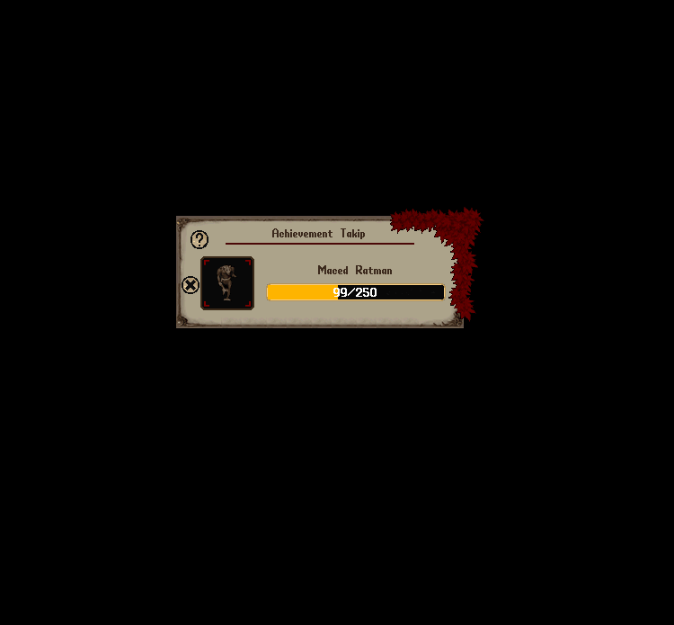

# Premium Sistemi

Premium sistemi, oyunculara <mark style="color:red;">**Quality of Life (QoL)**</mark> geliştirmeleri sunmak amacıyla tasarlanmış özel bir yapıdır.

Bu sistem sayesinde oyuncular, oyun deneyimlerini daha konforlu hale getiren çeşitli avantajlara sahip olurlar.

Premium özelliği, Donate sistemi üzerinden <mark style="color:red;">**250 Nimloth Puan**</mark> karşılığında satın alınabilir ve <mark style="color:red;">**satın alan hesaptaki tüm karakterleri için 30 gün süreyle geçerli olur**</mark>**.**

## Ev Geliştirmeleri

### Otomatik Ev Yenileme

Sunucudaki evler yenilenmezse <mark style="color:red;">**14 gün içerisinde yıkılmaktadır**</mark>.

Premium oyuncular için bu süreç otomatikleştirilmiştir:

Eğer bankanızda yeterli miktarda altın varsa, ev otomatik olarak yenilenir ve yıkım riski ortadan kalkar.

Eviniz yenilendiğinde eğer online isenir mesaj, değilseniz evinizin otomatik olarak yenilendiğine dair bir bildirim alırsınız.

### Profile Üzerinden Ev Takibi

Premium oyuncular, Profile menüsü üzerinden sahibi, ortağı veya dostu olduğu evleri görüntüleyebilirler.

Bunun yanı sıra eğer çantanızda boş rune marker varsa solda bulunan mavi butona tıklayarak eve ait koordinatın olduğu bir Rune Marker elde edebilirsiniz.

### Ev Satış Tabelası

Premium bir oyuncu evini satışa çıkardığında, evin üzerinde <mark style="color:red;">**“Satılık”**</mark> tabelası görünür hale gelir.

Bu sayede satılık evler diğer oyuncular tarafından kolayca fark edilebilir.

### House Keyring ile Ev İşaretleme

Premium oyuncular, [<mark style="color:red;">**House Keyring**</mark>](https://nimloth-uo.gitbook.io/wiki/esyalar/diger-esyalar/house-keyring) içerisinde kayıtlı evlerin konumlarını çantalarındaki boş bir Rune Marker’a işleyebilirler.

İşaretlemek istediğiniz evin yanındaki <mark style="color:red;">**Evi İşaretle**</mark> butonunu kullanarak evin giriş konumuna ait Rune Marker oluşturabilirsiniz.

## Player Vendor Geliştirmeleri

Premium oyuncuların Player Vendorlar üzerinden sağladığı özel avantajlar bulunmaktadır.

Bu sayede vendor yönetimi daha kolay hale gelir ve ticaret süreçleri daha verimli takip edilebilir.

### Satış Bildirimleri

Vendorunuzda bir satış olduğunda eğer online iseniz vendorunuzdan yapılan satışlar mesaj olarak bildirilir.

Premium oyuncularda satış bilgisi ayrıca bildirim sistemine kaydedilir. Böylece oyunda olmadığınız sırada gerçekleşen satışları da bildirimlerinizden takip edebilirsiniz.

### Son 10 Satışın Görüntülenmesi

Premium oyuncular, vendor üzerinden yapılmış son 10 satış işlemini ev menüsünden toplu şekilde görüntüleyebilirler.

Bu ekran üzerinden:

• Satılan eşyanın adı

• Eşyanın fiyatı

• Satın alan oyuncu

• Satış tarihi bilgilerini görüntüleyebilirler.

Böylece vendorunuzun performansını değerlendirebilir, en çok satan ürünleri belirleyebilir ve stok kontrolünü daha kolay şekilde sağlayabilirsiniz.

### Vendordan Para Tahsilatı

Normal şartlarda vendoru kaldırdığınızda veya vendordaki hasılatı almak istediğinizde, vendorda bulunan altın çantalarına düşer.

Premium oyuncularda ise altın otomatik olarak bankanıza gönderilir.

### İlan Panosunda Öncelik

Premium oyuncuların vendorlarında satışa sundukları eşyalar, İlan Panosu’nun varsayılan sıralamasında öncelikli olarak gösterilir.

Oyuncular listeyi eşya adı, fiyat veya satıcıya göre sıraladığında ise seçilen sıralama esas alınır. Aynı değere sahip ilanlarda Premium oyuncuların ilanlarına öncelik verilir.

## Craft Görev Sistemi Geliştirmeleri

Craft görev sisteminde oyuncular belirli görevleri tamamlayabilmek için çeşitli eşyalar üretmektedir.

Normal koşullarda, üretilen her eşya oyuncu tarafından Craft Quest Deed üzerine manuel olarak eklenmelidir.

Premium oyuncular için geliştirilen özellik sayesinde bu süreç çok daha kolay hale gelmektedir.

### Otomatik Üretilen Eşyaları Ekleme

Premium kullanıcıların Craft görev ekranında bir toggle bulunur. Bu özellik aktif edildiğinde:

• Üretilen görev eşyaları deed’e otomatik olarak eklenir,

• Oyuncunun tek tek ekleme yapmasına gerek kalmaz,

• Görev tamamlama süreci hızlanır ve daha kullanıcı dostu hale gelir.

Bu sistem özellikle yüksek hacimli üretim yapan oyuncular için ciddi bir zaman kazancı sağlamaktadır.

## Farming Sistemi Geliştirmeleri

Farming yeteneğiyle ilgilenen oyuncular için Premium avantajı büyük kolaylık sağlamaktadır.

Normal şartlarda ekilen bitkilerin durumlarını takip etmek zor ve zaman alan bir süreç olabilir.

Premium oyuncular ise bu süreci çok daha verimli şekilde yönetebilmektedir.

### Farmer’s Handbook

Provisioner vendorlarında satılan “Farmer’s Handbook” yalnızca Premium oyuncular tarafından kullanılabilen özel bir eşyadır.

Bu eşyaya çift tıklandığında, oyuncunun ektiği tüm bitkilere ait detaylı bir takip ekranı açılır.

Bu ekran aşağıdaki bilgileri kapsamaktadır:

Ekili tüm ürünlerin listesi

• Ürünlerin yaklaşık üreteceği mamül miktarı

• Sağlık durumu

• Kaç defa sulandığı

• Gübreleme durumu

• Aşı durumu

• Büyümesine kalan süre

• Tekrar sulanabilir ise ne zaman sulanabileceği

Bu özellik sayesinde çiftlik yönetimi çok daha sistematik hale gelir, ürün takibi kolaylaşır, verimlilik ve mamül üretimi ciddi şekilde artar.

## Reg Kristali Geliştirmeleri

Normal şartlarda Reg Crystal eşyasına çift tıklandığında, içindeki regler doğrudan oyuncunun çantasının sağ alt köşesine çıkar.

Ancak Premium oyuncular, reglerin nereye çıkarılacağını özel bir ayar ekranı üzerinden seçebilirler.

Reg kristaline tek tıklandığında, bir dialog ekranı açılır ve aşağıdaki seçenekler sunulur:

• Çantama çıkart – Regler doğrudan oyuncunun ana çantasına aktarılır.

• Bag içinde çıkart – Çantanın içerisinde bir bag oluşur ve regler buraya aktarılır.

• Seçtiğim çantaya çıkart – Oyuncu bir kez ilgili bag’i seçer, tüm regler her seferinde oraya aktarılır.

• Bulunduğu yere çıkart – Reg kristalinin bulunduğu container içine regler bırakılır

Bu özellik sayesinde Premium oyuncular regleri düzenli şekilde konumlandırabilirler.

## Duyuru Bildirimleri Yönetimi

Premium oyuncular, Profile menüsü üzerinden oyun içerisinde gösterilen çeşitli duyuru mesajlarını istedikleri şekilde aktif veya pasif hale getirebilirler.

Bu sayede oyuncular, görmek istemedikleri mesajları kapatarak daha kişisel ve temiz bir oyun arayüzü oluşturabilirler.

### Özelleştirilebilir Duyuru Türleri

Premium oyuncular, Profile menüsü üzerinden aşağıdaki duyuruları ayrı ayrı açıp kapatabilirler:

• Oyuncu ölüm mesajları\
• Kelle sallandırma mesajları\
• Etkinlik duyuruları\
• Korsanlık mesajları\
• Guild mesajları\
• Warzone karşılaşmalarının başlama ve sonuç mesajları\
• Düello sonuçları\
• Nadir bineklerin görüldüğü bölgelere ilişkin duyurular\
• Deniz ticareti mesajları

Bu özellik, yoğun savaş ve ticaret ortamlarında bilgi karmaşasını azaltarak daha keyifli ev özelleştirilebilir oyun deneyimi sağlar.

<figure><figcaption></figcaption></figure>

## Online Ödül Bonusu

Nimloth’da oyuncular, gün içerisinde [<mark style="color:red;">**çevrimiçi kaldıkları süreye bağlı**</mark>](https://nimloth-uo.gitbook.io/wiki/sistemler/online-odul-sistemi) olarak Nimloth Puanı kazanırlar.

Normal şartlarda gün içerisinde ilk 5 saat boyunca tamamladıkları her saat için <mark style="color:red;">**1 Nimloth Puanı**</mark> kazanırsınız.

Premium oyuncular, <mark style="color:red;">**5. saati tamamladıklarında 1 ek Nimloth Puanı**</mark> kazanırlar. Böylece günlük online ödülü normal oyuncularda toplam <mark style="color:red;">**5**</mark>, Premium oyuncularda toplam <mark style="color:red;">**6 Nimloth Puanı**</mark> olur.

Bu özellik Premium oyunculara, uzun vadede önemli bir avantaj sağlayarak oyun içi gelişim süreçlerini hızlandırır.

## Blueprint Görüntüleme

Premium oyuncular Profile menüsü altında yer alan Blueprintler sekmesi sayesinde tüm blueprint yapılarını kolayca takip edebilirler.

Bu sekme üzerinden sunucuda bulunan ve sahip olduğunuz Blueprintleri görüntüleyebilirsiniz.

Bu özellik, blueprint toplama ve geliştirme sürecinde büyük bir kolaylık sağlar ve oyuncuların planlama yapmasını mümkün kılar.

## Banka Hesap Sistemi Eklentisi

Premium oyuncular, banka hesapları üzerinden para transferi yaparken ek kolaylıklardan yararlanırlar.

Normal transfer işleyişine ek olarak Aile üyeleri ve Guild üyeleri transfer ekranında otomatik olarak listelenir ve kolayca seçilebilir.

Böylece oyuncular, tek tıklama ile hızlı ve güvenli bir şekilde altın aktarımı yapabilirler.

Bu özellik özellikle ticaretle ilgilenen, aktif guild yaşamına sahip veya çok karakterli oyunculara büyük hız ve kullanım rahatlığı sağlar.

## Eşya Transfer Sistemi Eklentisi

Premium oyuncular, eşya transferlerinde de ek kolaylıklardan yararlanırlar.

Normal transfer işleyişine ek olarak Aile üyeleri ve Guild üyeleri transfer ekranında otomatik olarak listelenir ve kolayca seçilebilir.

Böylece oyuncular, tek tıklama ile hızlı ve güvenli bir şekilde eşya aktarımı yapabilirler.

Bu özellik, aile ve guild içi eşya transferini kolaylaştırır, yanlış kişiye gönderim riskini azaltır ve transfer sürecini ciddi şekilde hızlandırır.

## Achievement Sistemi Eklentisi

Premium oyuncular, Achievement (Başarım) sisteminde gelişmiş takip özelliklerine sahip olurlar.

Normal şartlarda oyuncular başarımlarını genel arayüzden kontrol ederken, Premium kullanıcılar istedikleri başarımları anlık olarak takip edebilirler.

### Başarım Takip Özelliği

Premium oyuncular aynı anda en fazla 3 Achievement’ı aktif olarak takip edebilirler.

Help menüsündeki Başarımlar sekmesinde, her Achievement’ın yanında bulunan mavi takip butonuna tıklayarak ilgili Achievement’ı takibe alabilirler.

Takip edilen başarımlar için ekranda bir takip paneli görünür.

Bu başarımlarla ilgili her ilerleme sağlandığında panel otomatik olarak güncellenir.

Süreç boyunca oyuncu hedeflerine daha kolay hakim olur.

Takip paneli kapatılırsa, oyuncu .achi komutunu yazarak paneli tekrar açabilir.

Bu özellik, sistemde yer alan yüzlerce başarımı yönetmeyi çok daha pratik ve keyifli hâle getirir; oyuncular hedeflerine odaklanırken zaman kazanır.

### Achievement Takip Önerileri

Premium oyuncular, takip panelindeki <mark style="color:red;">**Takip Önerisi**</mark> butonunu kullanarak <mark style="color:red;">**500.000 altın**</mark> karşılığında bir öneri listesi oluşturabilirler.

Bu listede, ilerleme kaydettiğiniz ancak henüz tamamen bitirmediğiniz Achievement’lar arasından, <mark style="color:red;">**bir sonraki seviyesini tamamlamaya en yakın olduğunuz en fazla 10 Achievement**</mark> gösterilir. Zaten takip ettiğiniz Achievement’lar önerilere dahil edilmez.

Önerilen Achievement’ları, takip listenizde boş yer bulunması halinde doğrudan takibe alabilirsiniz. Aynı anda en fazla <mark style="color:red;">**3 Achievement**</mark> takip etme sınırı devam eder.

Oluşturulan liste <mark style="color:red;">**60 dakika boyunca**</mark> tekrar ücret ödemeden açılabilir. Bu süre boyunca liste yeniden hesaplanmaz. Süre dolduğunda yeni bir liste oluşturmak için yeniden ücret ödenir.

Önerilebilecek bir Achievement bulunamazsa ücret alınmaz.

<figure><figcaption></figcaption></figure>

<figure><figcaption></figcaption></figure>

## Ostard Egg Bilgilendirmesi

Ostard yetiştiriciliği yapan oyuncular, kurdukları Ostard Egg olgunlaştığında yumurtayı toplamak için 1 gün süreye sahiptir.

Eğer bu süre içerisinde yumurta toplanmazsa, yumurta çürür.

Premium oyuncular için bu süreç çok daha güvenli hâle getirilmiştir.

Bir Ostard Egg olgunlaştığında oyuncuya otomatik bir bildirim gönderilir ve böylece yumurtanın takibi kolaylaşır.

Bu bildirim sayesinde oyuncular yumurtayı zamanında toplama ve emeklerinin boşa gitmesini engelleme şansı elde ederler.

## Çanta Düzenleme

v3 client ile birlikte çanta düzeninizi tek bir tuş ile kaydedebilir ve dilediğiniz zaman eski hâline kolayca geri yükleyebilirsiniz.

Bu özellik özellikle aksiyon ve PvM odaklı oyuncular için büyük kolaylık sağlar. Savaş veya av sırasında çantanız karışsa bile, kayıtlı düzeninizi anında geri getirerek ekipman ve iksirlerinizi yeniden düzenlemekle vakit kaybetmezsiniz.

Pratik ve hızlı kullanımı sayesinde en yoğun anlarda bile hazırlıklı kalabilirsiniz.

Backpack altında yer alan soldaki butona tıklayarak çanta düzenini kaydedebilir, sağdaki buton ile de çanta düzeninizi geri getirebilirsiniz

Ayrıca BackpackLayout makrosu yardımı ile bu işlemleri macro tuşuna atayabilir, süreci daha da hızlandırabilirsiniz

## Sipariş Sistemi Eklentisi

[<mark style="color:red;">**Sipariş sisteminde**</mark>](https://nimloth-uo.gitbook.io/wiki/sistemler/siparis-sistemi) normal oyuncular aynı anda en fazla <mark style="color:red;">**5 açık sipariş**</mark> bulundurabilirken, Premium oyuncularda bu sınır <mark style="color:red;">**10 açık siparişe**</mark> çıkar.
