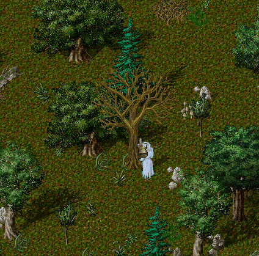

# Tree Grove Sistemi

Sosaria’nın ormanları artık daha da değerli! Yeni Tree Grove sistemi sayesinde Yew ve Trinsic bölgelerindeki ağaçlık alanlarda belirli aralıklarla ortaya çıkan özel ağaçları keserek nadir <mark style="color:red;">**Oak**</mark> ve <mark style="color:red;">**Yew**</mark> loglar elde edebilirsiniz.

## Tree Grove Nedir?

Sosaria üzerindeki ormanlık bölgelerde rastgele yerlerde beliren özel ağaçlara <mark style="color:red;">**Tree Grove**</mark> adı verilir. Bu ağaçlar, yalnızca odunculuk yeteneği 100 olan oyuncular tarafından kesilebilir. Ağacın türünü renk tonlarından anlayabilir veya doğrudan ağaca tıklayarak hangi tür olduğunu öğrenebilirsiniz.

### Kesim İçin Gerekenler

Tree Grove kesebilmek için Lumberjacking yeteneğinizin en az <mark style="color:red;">**100**</mark> olması gerekir.

Kesime başlamadan önce <mark style="color:red;">**Hatchet,**</mark> [<mark style="color:red;">**Silver Hatchet**</mark>](https://nimloth-uo.gitbook.io/wiki/esyalar/uretimtoplayici/silver-hatchet) veya [<mark style="color:red;">**Gold Hatchet**</mark>](https://nimloth-uo.gitbook.io/wiki/esyalar/uretimtoplayici/gold-hatchet) türlerinden birini elinize takmalısınız. Baltanın yalnızca çantanızda bulunması yeterli değildir.

Baltanız elinizdeyken <mark style="color:red;">**Tree Grove’a çift tıklayarak**</mark> kesimi başlatabilirsiniz.

Kullandığınız Hatchet’ın türüne göre elde edilen log miktarı ve başarısızlık ihtimali değişir. Silver Hatchet ve Gold Hatchet, normal Hatchet’a göre daha yüksek verim ve daha düşük başarısızlık ihtimali sağlar.

## Kesim Sırasında Dikkat Edilmesi Gerekenler

Kesim işlemi sırasında dikkat etmeniz gereken bazı önemli noktalar şunlardır:

• Kesim işlemi sırasında <mark style="color:red;">**hareket ederseniz**</mark>, işlem iptal olur.

• <mark style="color:red;">**Hasar alırsanız**</mark> , işlem iptal olur.

• <mark style="color:red;">**Başka bir eşyaya çift tıklarsanız**</mark>, işlem iptal olur.

• <mark style="color:red;">**Büyü kullanırsanız**</mark>, işlem iptal olur.

• <mark style="color:red;">**Elinizdeki Hatchet’ı bırakırsanız**</mark>, işlem iptal olur.

Not: Aynı anda yalnızca bir oyuncu aynı Tree Grove üzerinde kesim yapabilir. Başka biri kesim yapıyorsa, o işlem bitene kadar müdahale edemezsiniz.

<figure><figcaption></figcaption></figure>
